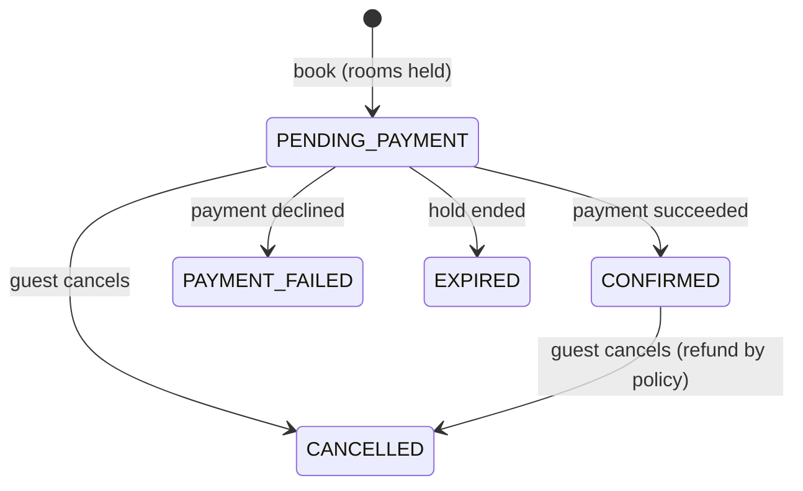
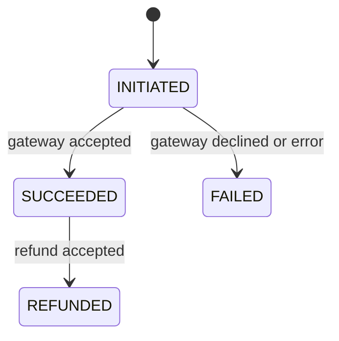

# Hotel Booking System
## Requirements
- Java 25
- No local Gradle needed (Gradle wrapper 9.9.2 included)

## Build and run
```bash
./gradlew clean build
./gradlew bootRun
```
The service starts on `http://localhost:8080`.

## Design decisions
- **In-memory repositories keep object references.** Entities are mutable aggregates, so the services serialise changes: one lock per `BookingId` for booking and payment changes, and one lock per room type for inventory (`RoomInventory` itself is not thread-safe, by design).

- **Payment idempotency is atomic in the repository.** `PaymentRepository.saveIfAbsent` uses `putIfAbsent` on the idempotency key, so two requests with one key cannot both create a payment. If the key already exists for the same booking, the service returns the existing payment. If it exists for a different booking, the service rejects the request with 422.
- **Cancellation policies are configuration.** `CancellationPolicyResolver` takes a `Map<CancellationPolicyType, CancellationPolicy>` and fails at start-up if a type is missing. The three tiered policies are built in the Spring configuration, not in the domain.
- **Search reads inventory without a lock.** The result is a snapshot. The binding availability check happens at booking time, under the room-type lock.

- **One instant per use case.** Each service method starts with `Clock.fixed(clock.instant(), clock.getZone())` and passes that clock to every domain call. "Valid at the start" then means "valid at confirm", so a guest is never charged and then rejected as expired.
- **Lock order: booking lock, then room type lock. Always.** `PaymentService`, `CancellationService` and the hold sweep take the booking lock and then call `InventoryService`, which takes the room type lock. `BookingService.book` takes only the room type lock. No path takes them the other way, so a deadlock cannot happen. All three services share one `KeyedLocks<BookingId>` bean.
- **Booking order: create, hold, save.** `Booking.hold` is the last step that can throw, so it runs before the inventory hold. `InventoryService.hold` checks every night before it holds any, so a failed booking needs no rollback.
- **Payment order: replay check, booking checks, charge.** All of it runs under the booking lock. A booking in the wrong state, or with an ended hold, is rejected before the gateway is called. A failed payment is final for its key; the guest must start a new booking, because `PAYMENT_FAILED` is terminal.
- **Two payment layers, one reason each.** A `PaymentProcessor` owns the rules of one method (instrument type, card expiry, the token). The `PaymentGateway` is the port to the outside system, which is mocked. `MockPaymentGateway` declines a token that ends in `0000` or contains `fail`. Tests count charges with `CountingGateway`, which lives in `src/test`. A gateway exception is a failed payment; on a refund it is a failed refund.
- **No Refund entity.** A refund is a quote (`RefundQuote`) plus the gateway answer, both returned in `CancellationOutcome`. `Payment.recordRefund` moves the payment to `REFUNDED` when the gateway accepts.

## REST API

| Method and path | Success | Notes |
|---|---|---|
| `POST /owners` | 201 | `Location` header is `/owners/{id}`. |
| `GET /owners/{id}` | 200 | Returns `propertyIds` and `multiProperty` (true when the owner has more than one property). |
| `POST /owners/{ownerId}/properties` | 201 | Room types are part of the body. |
| `GET /properties/search` | 200 | Query parameters. `amenities` is a comma list. Prices are INR per night. |
| `POST /bookings` | 201 | Holds the room. `Location` header is `/bookings/{id}`. |
| `GET /bookings/{id}` | 200 | |
| `POST /bookings/{id}/payments` | 200 | Header `Idempotency-Key` is required. |
| `POST /bookings/{id}/cancel` | 200 | Returns the booking and the refund. `refund.status` is `SUCCEEDED`, `FAILED` (see `failureReason`) or `NOT_APPLICABLE` (0% refund, or the booking was not paid). |

API docs: Swagger UI is at `/swagger-ui.html` and the OpenAPI JSON is at `/v3/api-docs` (springdoc reads the controllers and request/response records; the only doc annotations are `@ParameterObject` on the search query and `@ResponseStatus(CREATED)` on the create endpoints). springdoc lists every error status on every endpoint; the REST API table above is the source for which errors an endpoint really returns.

API rules:

- No entity leaves the API. Request records convert themselves (`toCommand`, `toInstrument`, `toCriteria`). Response records have a static `from(...)`. There are no mapper classes.
- Bean Validation checks only that a field is present. The domain checks ranges and rules, so a wrong value gives `DomainValidationException` and HTTP 400.
- A declined payment is HTTP 200 with `status: FAILED`. The request was valid and processed, and a replay with the same key returns the same body.
- Errors are RFC 9457 `ProblemDetail` with an extra `error` property (the exception name). An unexpected exception gives 500 with a generic `detail`; the cause is only in the log.
- Status map: 400 validation and capacity, 404 not found, 409 state, inventory and expired hold, 422 idempotency key reused for another booking.
- City and locality keep the case the owner typed. Search matches them without case.

## Package map

```
com.rupeek.hotel
 +- api             controllers, request/response records, ApiExceptionHandler
 +- application     services (booking, payment, cancellation, inventory, property), KeyedLocks, Spring config
 +- domain          model, value objects, search + filters, pricing, cancellation policy, payment ports,
 |                  repository interfaces, exceptions. No Spring.
 +- infrastructure  in-memory repositories, payment processors, MockPaymentGateway
```

Dependency direction: `api -> application -> domain <- infrastructure`. The domain depends on nothing.
`infrastructure` implements the interfaces (ports) that the domain declares. `DomainConfig` in `application.config` wires the parts.

## State diagrams

Every move goes through a `TransitionTable` kept in the status enum, so a wrong move throws `InvalidStateTransitionException` (409).





`PAYMENT_FAILED`, `EXPIRED`, `CANCELLED`, `FAILED` and `REFUNDED` are final.

## How to extend

| I want to add | Do this |
|---|---|
| A search filter | Implement `SearchFilter` and add it to the list in `DomainConfig.propertySearch`. Nothing else changes. |
| A payment method | Add a value to `PaymentMethodType`. Add a record to `PaymentInstrument` (it is sealed, so the compiler lists every `switch` to update). Add a processor that extends `GatewayPaymentProcessor` and gives the token. Add a request record and a case in `PaymentRequest.toInstrument()`. Start-up fails if a method has no processor. |
| A cancellation policy | Add a value to `CancellationPolicyType` and one entry in `DomainConfig.cancellationPolicyResolver`. Start-up fails if a type has no policy. A rule that is not "tiers by notice" is a new `CancellationPolicy` class. |
| A pricing rule | Implement `PricingStrategy`. For a weekend surcharge, write a decorator that wraps `NightlyPricingStrategy` and change the one bean in `DomainConfig`. |

## Trade-offs
- **One lock per room type.** Bookings of one room type queue behind each other, for any dates. It is simple and correct. Locks per room type and night, taken in date order, would let different dates run in parallel.
- **Search is a snapshot.** A room in the result can be gone when the guest books. The booking checks again under the lock.
- **Locks are never removed.** `KeyedLocks` keeps one lock per id, so memory grows with the number of bookings.
- **Hold expiry has two guards.** The sweep (every 30 s) frees the rooms of ended holds. A payment also checks the deadline itself, so a late payment is rejected even before the sweep runs.
- **Everything is in memory.** Data is lost on restart. The repository interfaces are the seam for a database.

## Try it

Start the service with `./gradlew bootRun`. Then run this in a bash shell (needs `curl` and `jq`).

```bash
BASE=http://localhost:8080
JSON='Content-Type: application/json'
IN=$(date -d '+30 days' +%F); OUT=$(date -d '+32 days' +%F)

# 1. owner and property (2 rooms of one type, MODERATE cancellation)
OWNER=$(curl -s -X POST $BASE/owners -H "$JSON" -d '{"name":"Asha","email":"asha@example.com"}' | jq -r .id)
PROP=$(curl -s -X POST $BASE/owners/$OWNER/properties -H "$JSON" -d '{
  "name":"Sea View","city":"Goa","locality":"Baga","stars":4,"amenities":["WIFI","POOL"],
  "cancellationPolicy":"MODERATE",
  "roomTypes":[{"name":"Deluxe","capacity":2,"units":2,"pricePerNight":{"amount":3000.00,"currency":"INR"}}]}')
PROPERTY_ID=$(echo "$PROP" | jq -r .id); ROOM_ID=$(echo "$PROP" | jq -r '.roomTypes[0].id')
curl -s $BASE/owners/$OWNER | jq

# 2. search
curl -s "$BASE/properties/search?city=goa&checkIn=$IN&checkOut=$OUT&guests=2&amenities=WIFI&maxPrice=4000" | jq

# 3. book (the room is held for 10 minutes)
BOOK='{"propertyId":"'$PROPERTY_ID'","roomTypeId":"'$ROOM_ID'","guestName":"Ravi","guestEmail":"ravi@example.com","checkIn":"'$IN'","checkOut":"'$OUT'","guests":2}'
B1=$(curl -s -X POST $BASE/bookings -H "$JSON" -d "$BOOK" | jq -r .id)

# 4. pay by card, then send the same Idempotency-Key again: the same paymentId comes back
CARD='{"method":"CARD","card":{"last4":"4242","expiry":"'$(date -d '+2 years' +%Y-%m)'","holderName":"Ravi"}}'
curl -s -X POST $BASE/bookings/$B1/payments -H "$JSON" -H 'Idempotency-Key: pay-1' -d "$CARD" | jq
curl -s -X POST $BASE/bookings/$B1/payments -H "$JSON" -H 'Idempotency-Key: pay-1' -d "$CARD" | jq .paymentId

# 5. cancel 30 days ahead: MODERATE refunds 100%
curl -s -X POST $BASE/bookings/$B1/cancel | jq

# 6. declined payment: a card that ends in 0000 is declined. HTTP 200, status FAILED, booking PAYMENT_FAILED
B2=$(curl -s -X POST $BASE/bookings -H "$JSON" -d "$BOOK" | jq -r .id)
curl -s -X POST $BASE/bookings/$B2/payments -H "$JSON" -H 'Idempotency-Key: pay-2' \
  -d '{"method":"CARD","card":{"last4":"0000","expiry":"'$(date -d '+2 years' +%Y-%m)'","holderName":"Ravi"}}' | jq

# 7. error shape: pay without the header gives 400, an unknown booking gives 404
curl -s -X POST $BASE/bookings/$B2/payments -H "$JSON" -d "$CARD" | jq
curl -s $BASE/bookings/00000000-0000-0000-0000-000000000000 | jq
```

## Assumptions
- Cancellation refund by notice before check-in (check-in is 12:00 in the hotel time zone; the longest matching notice wins; no match means 0%):

  | Policy | Notice before check-in | Refund |
  |---|---|---|
  | FLEXIBLE | 24 h or more | 100% |
  | FLEXIBLE | less than 24 h | 0% |
  | MODERATE | 72 h or more | 100% |
  | MODERATE | 24 h or more, less than 72 h | 50% |
  | MODERATE | less than 24 h | 0% |
  | NON_REFUNDABLE | any | 0% |
- The price range in a search is a price per night, in INR. Money values use 2 decimal places, so INR is the only currency that is tested.
- One booking is one room of one room type. A stay is 1 to 30 nights. A booking has 1 to 20 guests. A room type hosts 1 to 10 guests and a property has 1 to 5 stars.
- A booking is held for 10 minutes (`booking.hold-ttl`). The hold sweep runs every 30 seconds (`booking.sweep-interval`).
- There is no authentication or authorisation. Anyone who has a booking id can read, pay or cancel it.
- A failed payment ends the booking (`PAYMENT_FAILED` is final). The guest books again.
- A booking cannot be cancelled on the check-in day or later.
- Request DTOs are validated with Bean Validation (`@NotNull`, `@Valid`). A null that reaches the domain is a bug and maps to 500.

## With more time
- Gateway timeout means "unknown outcome", not "failed". A real gateway needs a status query or reconciliation job. Today any gateway exception marks the payment failed.
- Refunds: store them, and add a retry job (outbox) for failed refunds. A refund that the gateway rejects is returned to the caller as `FAILED`, but it is not stored (there is no refund repository), so nothing can retry it later.
- Bounded or striped locks. `KeyedLocks` never removes a lock, so memory grows with the number of bookings.
- Index properties by city. `findByCity` scans every property.
- A real database with optimistic locking (a `version` column on the booking).
- Search sorting and paging.
